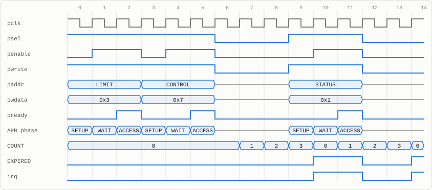
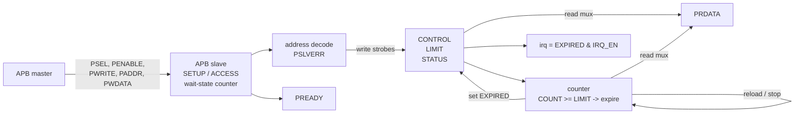
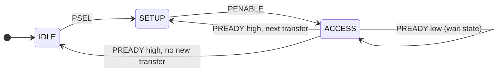
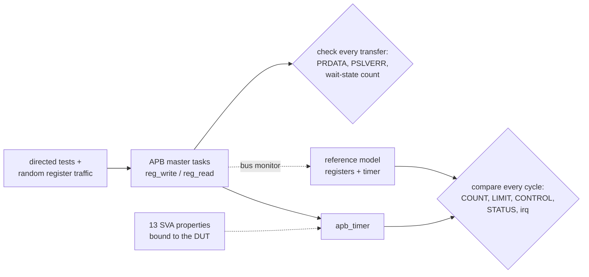

# AMBA APB Programmable Timer Peripheral

[](https://github.com/Divabhattacharya/apb-timer-peripheral/actions/workflows/tests.yml)


A programmable timer peripheral with an **AMBA APB (APB3) slave interface**,
written in SystemVerilog. It has four memory-mapped registers, one-shot and
periodic (auto-reload) modes, a sticky expiry flag with write-1-to-clear, and an
interrupt output. It can be built with any number of wait states.

Verification uses reusable APB master tasks and a cycle-accurate reference
model that compares the whole register state with the design on every cycle.
**13 concurrent assertions** cover the APB protocol and the timer behaviour.

<p align="center">
  <picture>
    <source media="(prefers-color-scheme: dark)" srcset="docs/waveform-dark.svg">
    
  </picture>
  <br>
  <sub>Captured from simulation, built with one wait state. Writing LIMIT = 3 and
  CONTROL = 0x7 (EN, PERIODIC, IRQ_EN) takes SETUP, WAIT and ACCESS phases each.
  COUNT then steps 0 → 3 and the timer expires, raising EXPIRED and <code>irq</code>.
  A write of 1 to STATUS clears them, and the timer expires again four cycles after the last one.</sub>
</p>

## At a glance

| | |
|---|---|
| **Bus** | AMBA APB3 slave: `PSEL`, `PENABLE`, `PWRITE`, `PADDR[11:0]`, `PWDATA`, `PRDATA`, `PREADY`, `PSLVERR` |
| **Wait states** | `WAIT_STATES` parameter (0 = zero-wait; tested with 0 and 2) |
| **Registers** | CONTROL, LIMIT, COUNT (read-only), STATUS (write-1-to-clear) |
| **Modes** | one-shot (EN clears itself on expiry) and periodic (COUNT auto-reloads) |
| **Expiry period** | LIMIT + 1 cycles |
| **Interrupt** | level `irq = EXPIRED & IRQ_EN` |
| **Error response** | `PSLVERR` for unmapped addresses and for writes to COUNT; no side effects |
| **Verification** | 2 configurations · 28,807 cycles · 6,616 APB transfers · 159,374 checks · 13 SVA properties · **0 errors** |
| **Quality** | Verilator `-Wall` lint clean; Yosys synthesis clean (68 flip-flops) |

## Register map

| Offset | Name | Access | Bits |
|---|---|---|---|
| `0x00` | CONTROL | RW | `[0]` EN: run; writing 1 while stopped restarts COUNT at 0<br>`[1]` MODE: 0 = one-shot, 1 = periodic<br>`[2]` IRQ_EN: interrupt enable |
| `0x04` | LIMIT | RW | `[31:0]` expiry value |
| `0x08` | COUNT | RO | `[31:0]` current count; writes return `PSLVERR` |
| `0x0C` | STATUS | W1C | `[0]` EXPIRED: set on expiry, cleared by writing 1 |

**Timer behaviour.** While EN = 1, COUNT steps 0, 1, …, LIMIT and expires on the
next cycle. On expiry EXPIRED is set; periodic mode reloads COUNT to 0, and
one-shot mode clears EN and holds COUNT.

- **Expiry is `COUNT >= LIMIT`.** Lowering LIMIT below the current count expires
  on the next cycle instead of counting through 2^32.
- **Expiry beats a clear.** If an expiry and a STATUS clear land in the same
  cycle, the expiry wins, so no event is lost.
- **No restart when already running.** Rewriting CONTROL while the timer runs
  (for example to change IRQ_EN) does not restart it.

## Architecture





## Verification



- **APB master tasks.** `apb_xfer` runs one SETUP cycle, then holds ACCESS until
  `PREADY`. `reg_write` and `reg_read` wrap it. Every transfer's `PRDATA`,
  `PSLVERR` and number of wait states are checked.
- **Reference model.** A cycle-accurate model of the register map and timer. It
  follows the bus by watching for completed transfers, and the full DUT state is
  compared with it on every cycle.
- **Assertions** (`sva/apb_timer_sva.sv`, attached with `bind`). Four protocol
  rules check the bus master itself: SETUP is always followed by ACCESS, ACCESS
  always follows SETUP, `PENABLE` needs `PSEL`, and the bus is stable during wait
  states. Two rules check the slave response, and seven check the timer (sticky
  STATUS, reload, one-shot stop, count stepping, irq).

| Test | What it checks |
|---|---|
| Reset values | all four registers read 0; `irq` low |
| Register access | LIMIT readback with 4 patterns; CONTROL readback; reserved bits read 0 |
| Error responses | write to COUNT and 6 unmapped/misaligned addresses → `PSLVERR`, `PRDATA` = 0, no side effects |
| One-shot | expiry after exactly LIMIT + 1 cycles; EN clears; COUNT holds; `irq` sticky until cleared; no second expiry |
| Periodic | first expiry after LIMIT + 1 cycles, then 5 more at exactly LIMIT + 1-cycle intervals |
| Enable / disable | COUNT freezes when stopped; re-enabling restarts from 0; rewriting CONTROL while running does not restart |
| Interrupt gating | EXPIRED is set but `irq` stays low until IRQ_EN; writing 0 to STATUS does not clear; writing 1 does |
| Set wins | LIMIT = 0 (expires every cycle): a clear in the same cycle as an expiry leaves EXPIRED set |
| LIMIT lowered | lowering LIMIT below COUNT expires on the next cycle and reloads |
| Random | 4,000 random operations (register writes and reads, error accesses, idle gaps) with async resets |

| Configuration | Cycles | APB transfers | Wait cycles | PSLVERR | Expiries (one-shot / periodic) | Async resets | Checks | Errors |
|---|---:|---:|---:|---:|---:|---:|---:|---:|
| 0 wait states | 11,200 | 3,298 | 0 | 344 | 141 / 299 | 9 | 63,641 | 0 |
| 2 wait states | 17,607 | 3,318 | 6,636 | 340 | 168 / 564 | 9 | 95,733 | 0 |

### The testbench catches real bugs

Each of these bugs was injected into the RTL on its own, and every one was caught:

| Injected bug | Caught by |
|---|---|
| Writes to COUNT accepted (no read-only protection) | scoreboard (`PSLVERR` check) |
| Address aliasing (only `PADDR[3:0]` decoded) | scoreboard |
| Expiry one cycle late (`>` instead of `>=`) | scoreboard (expiry timing) |
| One-shot mode keeps running | assertion `a_oneshot_stops` |
| Periodic mode does not reload | assertion `a_periodic_reload` |
| No restart when enabled | scoreboard |
| A STATUS clear beats a same-cycle expiry | assertion `a_expire_sets_status` |
| Writing 0 to STATUS clears it | assertion `a_status_sticky` |
| `irq` ignores IRQ_EN | assertion `a_irq` |
| One wait state too few | scoreboard (wait-state count, 2-wait-state configuration) |

## Run it

Requires Verilator 5 and Yosys.

```bash
make lint     # verilator --lint-only -Wall, with 0 and 2 wait states
make test     # build + run the testbench with assertions enabled
make synth    # Yosys synthesis + cell statistics
make wave     # VCD trace in build/apb_timer.vcd
```

## Repository layout

```
rtl/apb_timer.sv          APB slave, register file, timer core
sva/apb_timer_sva.sv      13 concurrent assertions + bind
tb/timer_test.sv          APB master tasks, reference model, directed + random tests
tb/tb_top.sv              runs the 0- and 2-wait-state configurations in parallel
docs/                     waveform figures
Makefile
```
